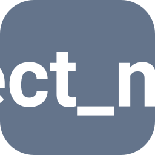

<div align="center">



# {{ cookiecutter.project_name }}

**{{ cookiecutter.project_description }}**


[](https://github.com/{{ cookiecutter.codeowner_username }}/{{ cookiecutter.repo_name }}/actions/workflows/qa.yml)
[](https://github.com/{{ cookiecutter.codeowner_username }}/{{ cookiecutter.repo_name }}/releases/latest)

[](https://www.python.org/)

[ }}-green)](LICENSE)

<!-- Uncomment the badges that apply:
[](https://pypi.org/project/{{ cookiecutter.package_name }}/)
[](https://github.com/{{ cookiecutter.codeowner_username }}/{{ cookiecutter.repo_name }}/pkgs/container/{{ cookiecutter.repo_name }})
[](https://{{ cookiecutter.repo_name }}.readthedocs.io)
-->
<br>
[](https://github.com/astral-sh/uv)
[](https://github.com/astral-sh/ruff)
[](https://mypy-lang.org/)

[Quick start](#quick-start) · [Usage](#usage) · [Development](#development)

</div>

---

_What it does, for whom, and why it's different, in two or three sentences._

## Features

- _**Feature.** What it gives the user._

## Quick start

```bash
uv sync
```

```bash
cp .env.example .env  # Configure as needed
uv run {{ cookiecutter.cli_command }}
```

## Usage

_The smallest example that shows the main thing it does._

## Development

Setup, QA, docs and releases: [DEVELOPMENT.md](DEVELOPMENT.md).

## Contributing

Issues and pull requests are welcome; `make qa` must pass.

## License

{{ cookiecutter.license }}: see [LICENSE](LICENSE).

---

<sub>🚀 Project starter provided by [Cookie Pyrate {{ cookiecutter.__cookiepyrate_version }}](https://github.com/gvieralopez/cookie-pyrate/tree/{{ cookiecutter.__cookiepyrate_version }})</sub>
